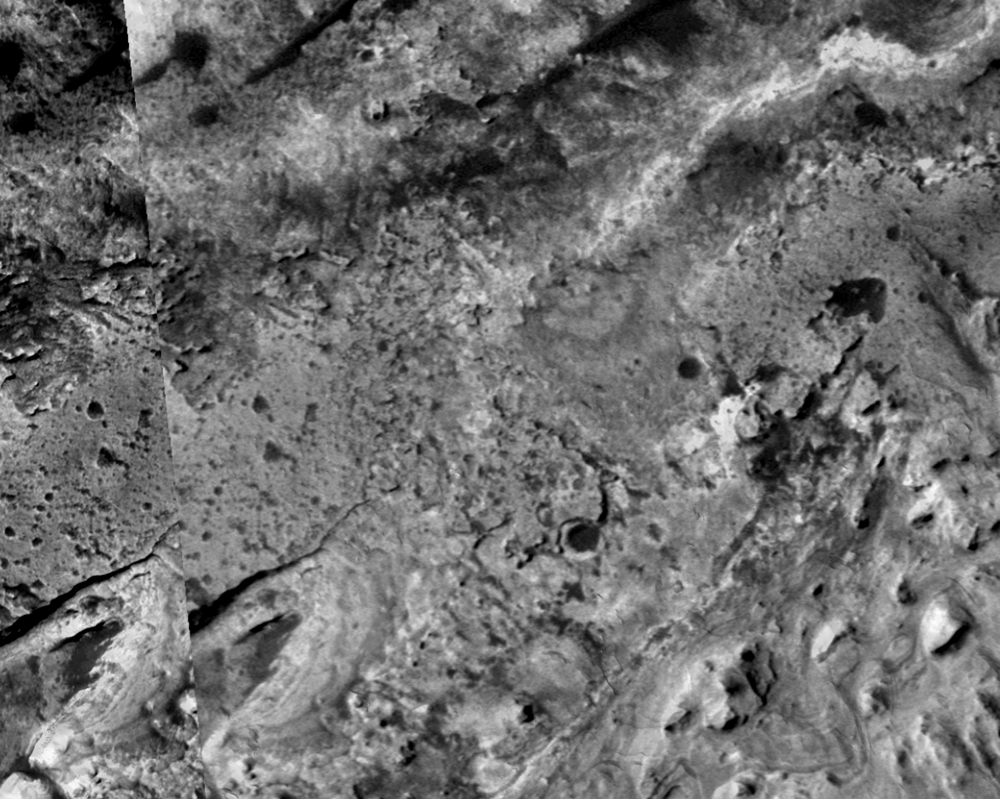

# A.R.E.S

**Advanced Regolith & Environmental Survivor** — an EVA traverse planner for the
first astronauts on Mars.

Existing Mars maps answer *"what is this place?"* A.R.E.S answers *"can two
people in suits walk this route and get back?"*

Pick a start, pick a destination, and it plans a route over a verified 1 m
digital elevation model of Gale Crater, then reports the numbers that decide a
walk: time, consumables, radiation dose, and the point at which the crew can no
longer return.



---

## NASA Space Apps Challenge 2026

Built for the **2026 NASA Space Apps Challenge**, in response to the challenge
on building a layered, integrated view of a location or route on the Martian
surface that helps a human explorer plan and carry out a Marswalk.

All data used is NASA or NASA-derived, accessed through the challenge's
recommended resources:

| Data | Source |
|---|---|
| Gale Crater DEM, 1 m | NASA/JPL **Mars Trek** |
| CTX mosaic, ~5 m | NASA/JPL-Caltech/MSSS, via **Mars Trek** |
| THEMIS IR Day 100 m mosaic | NASA/JPL/ASU, via USGS Astrogeology |
| MSL REMS weather, Sol 4995 | NASA/JPL/Centro de Astrobiología |
| MSL RAD dose rate | NASA/JPL/SwRI |

Full provenance, per dataset and per field: [`docs/data-manifest.csv`](docs/data-manifest.csv).

---

## Quick start

Requires Python 3.10+. No npm, no bundler, no build step, no network.

```bash
git clone <this-repo> && cd ares-mars-eva

python3 -m venv .venv
./.venv/bin/pip install -r pipeline/requirements.txt   # only needed to rebuild data

./serve.sh
```

Then open **http://localhost:8000/web/**.

`serve.sh` stages only `web/` and `data/out/` into a temporary directory, so the
5.4 GB raw DEM, `.venv/` and the research folder are never exposed.

### Rebuilding the data

The processed rasters in `data/out/` are committed, so you do not need to
rebuild anything to run the app. To regenerate them from source you need the
raw Mars Trek exports — see [`data/raw/README.md`](data/raw/README.md).

```bash
bash pipeline/run_all.sh
```

Without any raw data you can still start from synthetic terrain:

```bash
./.venv/bin/python pipeline/99_stub.py
```

---

## Using it

| Action | How |
|---|---|
| Move the destination | click the map (the pill reads `PLACE B`) |
| Move the start | press `SET` next to A, then click |
| Fine-tune either point | drag the A or B marker |
| Change the EVA budget | drag the budget slider — watch the PNR marker move |
| Toggle layers | Terrain, THEMIS IR, surface temperature, steep terrain, route |
| Simulate a solar particle event | `SEP EVENT (sim)` |

Scale and pan with the scroll wheel and the map background. `RESET VIEW`
returns to the full box.

---

## What is on screen

| Readout | Class |
|---|---|
| Distance, max slope, ascent, descent, elevation profile | **derived geometry** over the DEM |
| Cursor latitude / longitude / elevation | derived |
| Sol, air temperature, ground temperature, pressure, sky, UV, daylight | **measured** (REMS) |
| Walk time, surface temperature, radiation dose, point of no return, thermal advisory | **model estimates** |

Every number is classified in [`docs/methodology.md`](docs/methodology.md) §8,
with its formula, its inputs and its error bar.

---

## Repository layout

```
web/                             the app (plain ES modules, no dependencies)
  js/router.js                   weighted A* over the cost grid
  js/eva.js                      suit model: speed, time, temperature, dose, PNR
  js/app.js                      canvas map, endpoints, panels

pipeline/                        Python: raw rasters in, web products out
  config.json                    single source of truth
  01_grid.py … 08_themis.py      processing steps
  run_all.sh                     full rebuild

data/out/                        products the app loads (committed)
data/reference/Gale_DEM_8m.tif   whole 36 × 40 km extent at 8 m/px
data/raw/                        raw inputs (not committed, 5.4 GB)

docs/
  methodology.md                 the authoritative technical document
  data-manifest.csv              per-dataset provenance
  submission.md                  submission write-up and references

brainstorming-initial-research/  initial notes and reference material
```

---

## Model and limitations, in short

The DEM drives everything: slope and roughness become a cost raster, and A\*
finds the cheapest path across it. Time is derived afterwards from a suited
walking speed of 1.2 m/s, derated by grade and surface roughness. Dose is the
RAD background rate multiplied by duration. Thermal risk is relative — route
segments below the box's 10th-percentile temperature — because no defensible
absolute suit limit exists.

Known limits, stated plainly:

- **Walk time is the weakest number** — about ±50%, because no human has walked
  on Mars and every speed constant is an Earth analogue.
- **A\* ignores the budget, radiation and temperature.** They are reported, never
  enforced.
- **The temperature layer is modelled**, not measured: it captures spatial
  variation only, with no diurnal term, while REMS measures an 88 °C swing.
- **No spectral, geophysical or chemical data** is included.
- **No validation against Curiosity's actual traverse** has been done yet.

Full treatment: [`docs/methodology.md`](docs/methodology.md) §10–§12.

---

## Credits

Mars data: NASA/JPL, NASA/JPL-Caltech/MSSS, NASA/JPL/Arizona State University,
NASA/JPL/SwRI, NASA/JPL/Centro de Astrobiología, USGS Astrogeology.

Reference material: J. A. Hoffman, *EVA: Walking and Working in Space*
(`brainstorming-initial-research/`).

No NASA, JPL or mission logos are used anywhere in this project.
